  

  

## 🚀 Sobre mim
Desenvolvedor Front-end & UI/UX Designer. Crio experiências digitais completas — desde a concepção visual e prototipagem (UI/UX) até o desenvolvimento de interfaces modernas com HTML5, CSS3 e JavaScript, conectando-as com APIs para criar sites dinâmicos e inteligentes que geram resultados para empresas.

## 🟣 Nexa · o que estou construindo

  

A **Nexa** é um ERP cognitivo, nascido dentro de uma fábrica. Reúne estoque com cores e numerações, pedidos, produção, trocas, contagem pelo celular e o chat da equipe, num visual escuro e limpo, em preto e roxo.

- 🖥️ **Aplicativo** para Windows e celular, sempre atualizado e ao vivo para todos
- ✨ **Simples de verdade:** palavras fáceis, poucos cliques e nada apagado, tudo registrado
- 🧠 **Nexus AI** *(em desenvolvimento)*: encontra, avisa e prepara tarefas, mas quem decide é sempre uma pessoa
- 🏬 **Em breve:** um CRM que conecta a fábrica às lojas

  

  

## 🛠 Minhas Ferramentas

## 📊 Minhas Estatísticas

  <table>
    <tr>
      <td align="center">
        
      </td>
      <td align="center">
        
      </td>
    </tr>
  </table>

## 💼 No que estou trabalhando no momento?
- 🟣 Construindo a **Nexa**, um ERP cognitivo com IA, do design ao banco de dados.
- 💼 Desenvolvendo soluções web personalizadas e interfaces de alto desempenho para empresas.
- 🎨 Aperfeiçoando protótipos de alta fidelidade no **Figma** com foco em conversão e experiência do usuário (**UI/UX**).
- 🔗 Integrando e consumindo **APIs** para tornar as interfaces dinâmicas.

## ⚡ Curiosidades sobre mim
- 🌱 Atualmente estudando novas técnicas de animação com CSS e JavaScript.
- 🎯 Meu objetivo é criar o equilíbrio perfeito entre um design bonito e um código limpo.
- ⚡ **Fato divertido:** Passo metade do tempo criando o design no Figma e a outra metade ajustando aquele pixel que ficou fora do lugar!

## 🎓 Aprendendo e Evoluindo
- 📚 Atualmente me aprofundando em **React.js** para criar interfaces ainda mais robustas.
- 🧪 Estudando **Clean Code** para melhorar a manutenção das APIs que consumo.

## 🔗 Vamos nos conectar?

